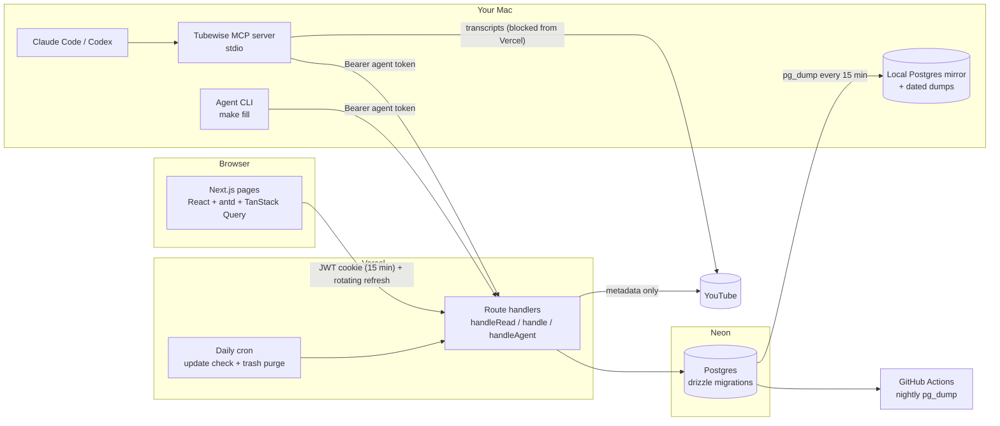

# Tubewise

Turn any YouTube video or playlist into a course you actually finish: lessons laid out as a daily route, written
notes, practice and a quiz for every video, written by an AI agent from the video's own transcript.

**Live:** _coming soon (Vercel)_ · anyone can browse; logging in unlocks changes.

| Library | Course route | Lesson notes |
|---|---|---|
|  |  |  |

## What it does

- **Paste a link** → a course. Playlists become one lesson per video; long videos with chapters are split per chapter.
- **Notes by an AI agent** (Claude Code or Codex) from each lesson's transcript: a scannable summary with timestamp
  links, easy/medium/hard practice (real LeetCode/GFG problems for DSA), and a quiz whose wrong answers seek the video
  to the moment that explains it. Server-side checks reject template-looking notes and shuffle answer positions.
- **Learn**: embedded player with speed/theater/auto-next, a 30–120 min daily plan drawn as metro stops, progress,
  and your own timestamped notes.
- **Stays current**: a daily check counts new playlist videos; you add them with one click.
- **Optional AI tutor**: "Ask this lesson" (Claude Haiku), grounded in the lesson, with daily caps. Off without a key.

## Architecture



Why it's shaped like this:

- **YouTube blocks caption downloads from Vercel**, so the online app stores metadata only and the Mac fetches
  transcripts and uploads them through the agent API (MCP tool `fetch_transcripts`).
- **Reading is public, writing needs the owner login.** Reads go through `handleRead()` (optional user); every write
  through `handle()` (401/403). The UI hides write controls with `useSession()`.
- **Auth** is hand-rolled on purpose: argon2id passwords with lockout, a 15-minute HS256 JWT in an httpOnly cookie, a
  refresh token stored only as SHA-256 that rotates on every use with a 24 h sliding idle expiry; replaying a
  rotated-away refresh token revokes every session. The client refreshes once and replays the request (ky hook).
- **Agents get their own credentials**: personal agent tokens (shown once, hashed, revocable) that can read, upload
  transcripts and save notes, but never delete.
- **Backups beyond Neon's 6 h free window**: dated dumps on the Mac every 15 minutes (14 days kept), a read-only
  "Local backup" view switchable in Settings, nightly off-site dumps in GitHub Actions, and a 7-day trash.

## Run it

```bash
make install          # bun install
cp .env.example .env.local   # DATABASE_URL (Neon), JWT_SECRET
make db-migrate       # create the schema
make user NAME=you    # create your login (hidden password prompt; only a hash is stored)
make dev              # http://localhost:3000
```

Requirements: bun, Node ≥ 22, a Postgres URL. Everything is free-tier; the AI tutor is the only paid part and stays off
unless `ANTHROPIC_API_KEY` is set.

## Filling notes with an agent

1. Copy a course id in the app.
2. In Claude Code or Codex: *"Fill notes for course `<id>`"*. With the MCP server registered
   (`make mcp-add URL=… TOKEN=…`, see [docs/mcp.md](docs/mcp.md)) the agent fetches transcripts on your Mac, writes
   each lesson by hand and saves it through the API. Without it, the same works locally through the CLI.
3. For many lessons, `make fill ID=<course-id> AGENT=claude` runs one fresh agent session per lesson so the last lesson
   gets the same care as the first. It works against the online app when `TUBEWISE_URL` + `TUBEWISE_TOKEN` are set.

The writing rules agents follow are in [docs/notes-guide.md](docs/notes-guide.md).

## Commands

| Command | What it does |
|---|---|
| `make dev` / `make build` | dev server / production build |
| `make check` | typecheck + lint + self-tests |
| `make list`, `make pending ID=…`, `make show ID=…`, `make report ID=…` | agent CLI views |
| `make fill ID=… AGENT=claude\|codex MAX=n` | fill pending lessons, one agent session each |
| `make db-generate` / `make db-migrate` | schema migrations (drizzle-kit) |
| `make user NAME=…` | create a login or reset its password (hidden prompt) |
| `make db-backup` / `make backup-install` | dump Neon (+ refresh the local mirror) / every 15 min via launchd |
| `make mcp-add URL=… TOKEN=…` | register the MCP server in Claude Code (user scope) |

## Where things live

| What | Where |
|---|---|
| Pages (public) and Settings | `src/app/(app)/`, login at `src/app/login/` |
| API | `src/app/api/` (app), `src/app/api/agent/` (agent tokens), `src/app/api/auth/` |
| Server | `src/server/` (auth, db, repo, services, youtube) |
| Client | `src/components/`, `src/client/` (hooks, store, api) |
| Agent tooling | `mcp/server.ts`, `src/agent-client/`, `scripts/agent/` |
| Docs | [AGENTS.md](AGENTS.md) (code), [docs/online-plan.md](docs/online-plan.md) (how it got online) |

Stack: Next.js 16 (App Router, `proxy.ts`) · TypeScript · React 19 · antd 6 · TanStack Query · zustand · ky ·
Postgres on Neon (node-postgres + drizzle) · jose · @node-rs/argon2 · MCP SDK · Anthropic SDK · youtubei.js ·
youtube-transcript-plus · Vercel.
