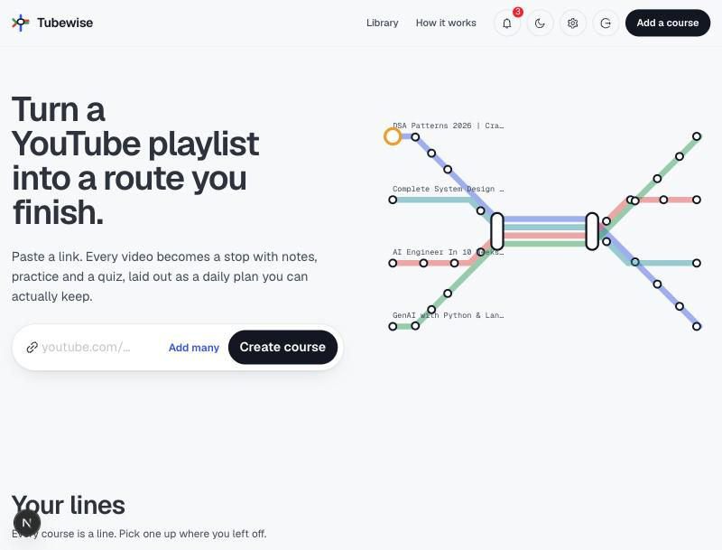
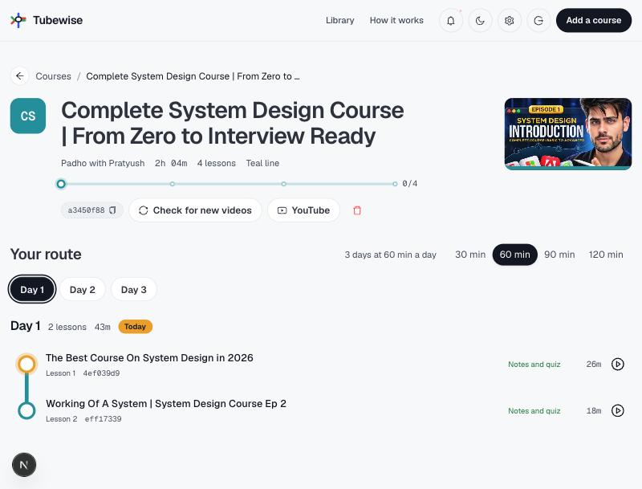
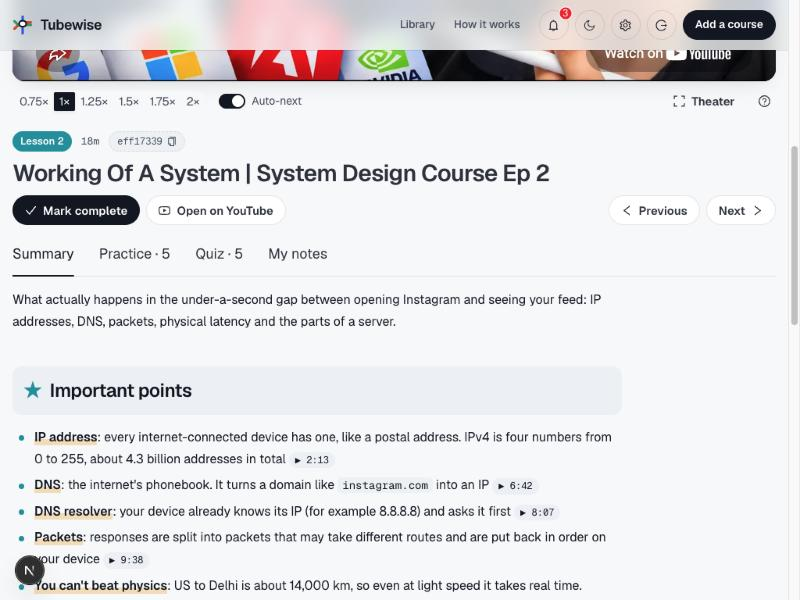
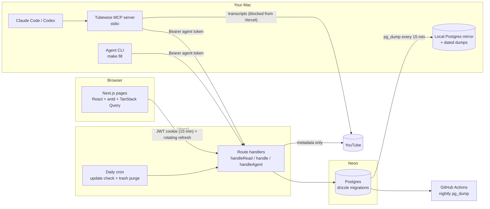

# Tubewise

**Turn any YouTube playlist into a course you actually finish.** Every video becomes a lesson with written notes,
practice problems and a quiz, generated by an AI coding agent from the video's own transcript, and laid out as a
daily route you can keep.

**Live:** [tubewise.vercel.app](https://tubewise.vercel.app): anyone can browse; logging in unlocks changes.

| Library | Course route | Lesson notes |
|---|---|---|
|  |  |  |

---

## Why it exists

YouTube has excellent free courses, but a 40-video playlist is easy to start and hard to finish: no notes, no
practice, no sense of progress, and rewatching to find "that one explanation" eats the time you meant to learn with.

Tubewise turns a playlist link into a structured course:

- **A route, not a list.** Lessons are drawn as metro stops and split into a 30–120 minute daily plan.
- **Notes you can trust.** Each lesson gets a scannable summary with clickable timestamps, easy/medium/hard practice
  (real LeetCode/GFG problems for DSA courses) and a quiz. A wrong answer jumps the video to the moment that explains it.
- **Written from the transcript, checked by code.** An AI agent (Claude Code or Codex) writes every lesson by hand
  from its own transcript; the server rejects notes that look templated and shuffles answer positions.
- **Stays current.** A daily job counts new videos in each playlist; adding them is one click.

## What's inside

- **Course import:** paste a video or playlist link. Playlists become one lesson per video; long videos with YouTube
  chapters are split into one lesson per chapter.
- **Learning UI:** embedded player (speed, theater mode, auto-next, keyboard shortcuts), progress, a daily plan,
  timestamped personal notes, quizzes that seek the video, light/dark "Transit" theme.
- **Public read, private write:** visitors can browse every course and lesson; only the owner can add, sync, delete,
  track progress or edit notes.
- **AI agent integration:** a custom MCP server and a CLI let Claude Code or Codex fetch transcripts, write notes and
  save them, through a scoped agent API that can never delete anything.
- **Backups beyond the free tier:** dated dumps every 15 minutes, a read-only local mirror you can switch to in the
  UI, nightly off-site dumps in GitHub Actions, and a 7-day trash for deleted courses.
- **Optional AI tutor:** "Ask this lesson" (Claude Haiku), grounded in the lesson's notes and transcript, with daily caps.
  Off unless you add an API key; everything else is free-tier.

## Architecture



Request flow: component → hook (TanStack Query) → `client/api.ts` (ky) → `app/api/*` route →
`server/services` / `server/repo` → Postgres (drizzle). Every route goes through one of four wrappers that decide who
may call it: `handleRead` (public, optional user), `handle` (owner-only writes), `handleAgent` (Bearer agent token),
`handlePublic` (login/refresh/cron).

## Engineering highlights: the hard parts and how they're handled

### 1. YouTube blocks transcript downloads from cloud servers
Tested from a throwaway Vercel deploy: playlist and video metadata work, but every caption request failed (5 out of 5),
while the same video returned 675 caption lines from a home connection. Paid proxies were ruled out (everything must
stay free).

**Solution: split the work by where it can run.** The website stores metadata only and marks lessons
`transcript pending`. The Mac (where the AI agent runs anyway) downloads captions and uploads them through the agent
API. A `PROXY_URL` hook is documented but deliberately unwired.

### 2. AI-written notes that pass every check but teach nothing
An early batch generated 37 lessons from one template: every count was right, the content was useless.

**Solution: make quality mechanical where possible, and keep context small.**
- `save` validates the JSON with zod, then a quality gate (`src/shared/content-quality.ts`) rejects notes whose
  timestamps sit on an even grid or match no real transcript line, quiz options copied from the summary, sentences
  reused from other lessons, and quizzes where the longest option is usually the right one.
- Answer positions are shuffled server-side, avoiding all-A runs and orders other lessons already use.
- `make fill` runs **one fresh agent session per lesson**, so cost grows linearly and lesson 100 gets the same care as
  lesson 1 (no long context full of earlier transcripts).
- Transcripts are compacted (captions merged into ~12 s blocks, repeats removed) before the agent reads them.

### 3. Hand-rolled authentication, done properly
- Passwords: argon2id; 5 failed logins lock the username for 15 minutes; "no such user" takes as long as "wrong password".
- Access: a 15-minute HS256 JWT (jose) in an httpOnly cookie.
- Refresh: 32 random bytes stored only as SHA-256, scoped to `/api/auth`, rotated on every use, 24 h sliding idle
  expiry. **Replaying any rotated-away token revokes every session** (theft detection), with a 30 s grace window so
  two tabs refreshing at once don't log you out.
- Client: a ky `afterResponse` hook refreshes once on `token_expired` and replays the request. Plain ky with
  `retry: 0` never keeps a copy of the request body, so replaying a POST would send it empty; the client therefore
  sets a retry limit of 1 with no retryable methods or status codes, which makes ky keep an unread copy of the body
  without ever retrying on its own.
- The app is public to read; every write is owner-only on the server, and the UI hides controls that would fail.
- Unexpected server errors return a generic message; details go to logs and the owner's notification feed only.
- Verified with 13 scripted scenarios (expiry, rotation, reuse revocation, idle expiry, lockout, logout) plus
  browser checks.

### 4. Moving a live app from SQLite to Postgres without losing anything
The original app was a local SQLite tool with synchronous queries. Moving to Neon meant ~54 synchronous call sites
became async, migrate-on-load became versioned drizzle-kit migrations, and a one-time copy script moved every row
with its original ids, so shared links kept working. Timestamps stay epoch-millisecond `bigint`s, so the API shapes
and the whole frontend were untouched.

### 5. Letting AI agents write to production safely
Agents get **personal agent tokens**: shown once, stored hashed, revocable from Settings, owner-only. The agent API
(`/api/agent/*`) can read lessons, upload transcripts and save notes, and has no delete routes at all (405). The same
quality gate applies to agent saves. The MCP server is a thin stdio client of that API, so Claude Code, Claude
Desktop and Codex all get the same guarded access.

### 6. Backups on a free tier with a 6-hour restore window
- `scripts/backup.sh`: `pg_dump` of Neon's direct endpoint → dated dumps (14 days kept) → `pg_restore` into a local
  Postgres mirror. Runs every 15 min via launchd, or from a "Back up now" button in Settings.
- **Read-only local view:** the db handle is a proxy that picks Neon or the mirror *per request* (AsyncLocalStorage +
  a cookie), so the whole app can browse the backup without passing a connection around; auth, the agent API and
  every write always use Neon.
- Nightly `pg_dump` in GitHub Actions (14-day artifacts) for an off-site copy; soft delete with a 7-day trash.

### 7. Small things that bite
- Vercel's import screen pre-fills env vars from `.env.example`; a placeholder `DATABASE_URL` made every query fail
  with `ENOTFOUND`. The example file now has every value commented out.
- The MCP server must start from any folder: relative imports only, CommonJS-safe (no top-level await), and the
  repo's own `tsx` instead of `bunx`.
- `pg_dump` with `sslmode=verify-full` needs `PGSSLROOTCERT=system`, scoped to Neon only so the local mirror
  (no SSL) still works.

## Tech stack and what each piece is for

| Technology | Purpose here |
|---|---|
| **Next.js 16** (App Router, route handlers, `proxy.ts`) | UI and JSON API in one deploy; proxy guards the Settings page |
| **React 19 + TypeScript** | UI; strict types shared between server and client (`src/shared`) |
| **antd 6** | Component library, themed into the "Transit" look (Geist / Geist Mono) |
| **TanStack Query + ky + zustand** | Server state and caching, HTTP with the auth-refresh hook, local UI prefs |
| **Postgres on Neon** | Primary database (serverless, free tier, pooled connections) |
| **drizzle-orm + drizzle-kit + node-postgres** | Typed queries, real transactions, versioned SQL migrations |
| **Vercel** (+ Cron) | Hosting from GitHub, daily update check and trash purge |
| **jose, @node-rs/argon2** | JWT access tokens, password hashing |
| **zod** | Validation of agent-written content and API bodies |
| **youtubei.js, youtube-transcript-plus** | Playlist/video/chapter metadata, captions |
| **@modelcontextprotocol/sdk** | The Tubewise MCP server for Claude Code / Claude Desktop / Codex |
| **@anthropic-ai/sdk** (Claude Haiku) | Optional "Ask this lesson" tutor, streamed, prompt-cached, capped |
| **dnd-kit, react-markdown + remark-gfm** | Drag-to-reorder library, rendered notes with timestamp links |
| **bun, tsx, Make** | Package manager, TypeScript scripts on Node, one-word commands |
| **GitHub Actions, launchd, pg_dump** | Nightly off-site dumps, 15-minute local dumps and mirror |

## Using it (as the owner)

1. **Add a course:** log in, paste a YouTube video or playlist link. Lessons appear immediately.
2. **Get transcripts:** online, lessons start as `transcript pending`; your Mac fetches them (MCP tool
   `fetch_transcripts` or `bun run agent transcripts <course-id>`). Locally they download on their own.
3. **Write notes:** copy the course id and tell Claude Code or Codex *"Fill notes for course `<id>`"*, or run
   `make fill ID=<course-id> AGENT=claude` for one fresh session per lesson. Rules: [docs/notes-guide.md](docs/notes-guide.md).
4. **Learn:** pick a daily pace, watch, take timestamped notes, do the quiz; wrong answers jump to the explanation.
5. **Stay current:** new playlist videos show as "+N new"; click to add them.
6. **Safety:** Settings → Data source → "Back up now"; deleted courses stay in Settings → Trash for 7 days.

## Fork it and run your own

You need: [bun](https://bun.sh), Node 22+, a free [Neon](https://neon.tech) account, and (to go online) a free
[Vercel](https://vercel.com) account. Claude Code or Codex for writing notes.

### 1. Run it locally

```bash
git clone https://github.com/<you>/yt-playlist-course.git && cd yt-playlist-course
make install                  # bun install
cp .env.example .env.local    # then uncomment and fill in the two values below
```

In `.env.local`:

- `DATABASE_URL`: your Neon **pooled** connection string (host contains `-pooler`); change `sslmode=require` to
  `sslmode=verify-full`.
- `JWT_SECRET`: `openssl rand -base64 48`.

```bash
make db-migrate               # create the schema in Neon
make user NAME=you            # your owner login (hidden password prompt; only a hash is stored)
make dev                      # http://localhost:3000
```

Log in, paste a playlist link, then ask your agent to fill the notes. Run `make check` before changing code.

### 2. Put it online (Vercel, from GitHub)

1. **vercel.com/new → Import** your fork. Framework: Next.js (auto); install/build: defaults (bun is detected).
2. **Environment variables:** set real values, **Production only**:
   `DATABASE_URL` (same Neon URL), `JWT_SECRET` (a **new** `openssl rand -base64 48`; different from local on
   purpose), `CRON_SECRET` (`openssl rand -hex 24`). If the import screen pre-filled anything, replace it.
3. **Deploy.** If your default branch isn't the one you want live, set **Settings → Environments → Production →
   Branch Tracking**, then redeploy. Env var changes only apply after a redeploy.
4. Check: logged out you can browse; logged in you can add courses; **Settings → Cron Jobs** lists
   `/api/cron/check-updates`.

### 3. Connect your AI agent (MCP)

1. In your live app: **Settings → Agent tokens → Create token** (shown once).
2. Claude Code: `make mcp-add URL=https://<your-app>.vercel.app TOKEN=tw_...`, then restart it.
3. Claude Desktop / Codex: same server, configured in their config files. See [docs/mcp.md](docs/mcp.md).
4. Without MCP (any agent with a terminal): `export TUBEWISE_URL=… TUBEWISE_TOKEN=…` switches the CLI
   (`bun run agent …`, `make fill`) to the live app.

### 4. Optional extras

| Want | Do |
|---|---|
| Local read-only mirror + dated dumps | `createdb tubewise_mirror` (e.g. Homebrew Postgres), set `LOCAL_DATABASE_URL` in `.env.local`, then `make db-backup` or `make backup-install` (every 15 min) |
| Nightly off-site backups | add repository secret `NEON_DATABASE_URL` (Neon **direct** URL, no `-pooler`); `.github/workflows/backup.yml` runs daily |
| AI tutor | set `ANTHROPIC_API_KEY` (locally and/or in Vercel); caps via `TUTOR_DAILY_CAP_OWNER` / `TUTOR_DAILY_CAP_PUBLIC` |

## Commands

| Command | What it does |
|---|---|
| `make dev` / `make build` | dev server / production build |
| `make check` | typecheck + lint + self-tests |
| `make db-generate` / `make db-migrate` | new migration from `schema.ts` / apply migrations |
| `make user NAME=…` | create a login or reset its password |
| `make list`, `make pending ID=…`, `make show ID=…`, `make report ID=…` | agent CLI views |
| `make fill ID=… AGENT=claude\|codex MAX=n` | fill pending lessons, one agent session each |
| `make mcp-add URL=… TOKEN=…` | register the MCP server in Claude Code |
| `make db-backup` / `make backup-install` / `make backup-uninstall` | dump + refresh mirror / every 15 min / stop |

Run `make` for the full list.

## Project layout

| Path | What |
|---|---|
| `src/app/(app)/` | Pages: library, course, lesson, settings (login at `src/app/login/`) |
| `src/app/api/` | App routes; `api/agent/*` for agent tokens; `api/auth/*`; `api/cron/*` |
| `src/server/` | `auth/`, `db/` (schema, client), `repo/`, `services/`, `youtube/` |
| `src/client/`, `src/components/` | Hooks, API client, stores; UI components |
| `src/shared/` | Types, content schema and quality gate, formatting shared by server, CLI and MCP |
| `mcp/`, `src/agent-client/`, `scripts/agent/` | MCP server, agent API client, CLI (local and remote modes) |
| `drizzle/` | SQL migrations |
| `docs/` | [notes-guide](docs/notes-guide.md), [mcp](docs/mcp.md), [online-plan](docs/online-plan.md) (build log) |

## Limits and next steps

- Single owner by design. A second *owner* account would need every query scoped by `user_id`.
- Transcripts for courses added online arrive only when your Mac runs the agent or CLI (YouTube blocks the cloud).
- No license file yet: until one is added, the code is all rights reserved.
